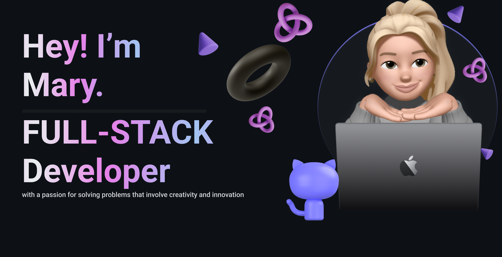

<!-- Palette from img/banner.png: bg #0d1117 · pink #e879f9 · violet #8b5cf6 · periwinkle #a5b4fc · text #e6edf3 -->

  

  
  
  
  
  

---

## 👋 Holla

I'm a **Frontend-focused Software Developer** with strong experience in **React** and **Next.js** and hands-on backend exposure. I build performant, accessible, user-centric web apps, collaborate across teams, and enjoy solving real-world problems while improving both user and developer experience.

<table>
<tr>
<td width="50%" valign="top">

**🌱 Currently learning**
- Flutter & PHP
- Spanish 🇪🇸

**🌍 Open source**
- React / Next.js ecosystem — frontend
- UI polish, performance & docs

</td>
<td width="50%" valign="top">

**⚡ Fun facts**
- 🎹 Piano enthusiast, obsessed with music
- 🧠 LeetCode keeps my brain sharp
- 📖 Reading *Atomic Habits* by James Clear
- ✈️ Love adventures & travel
- 😄 Pronouns: she / her

</td>
</tr>
</table>

## 🧠 Tech Stack

  

**Familiar with**

  

## 📊 GitHub Activity

  
  

  

## 😎 More about me

Coming from **Mechatronics Engineering and Metallurgy**, I bring technical acumen, critical thinking and a results-oriented mindset to building software. That multidisciplinary background helps me tackle complex challenges and pick up new technologies quickly.

I'm driven by innovation, committed to continuous growth, and always pushing the boundaries of what's possible in tech.

